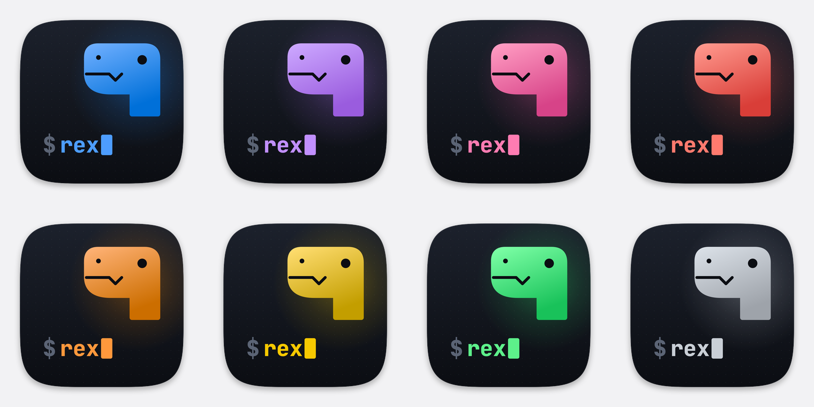
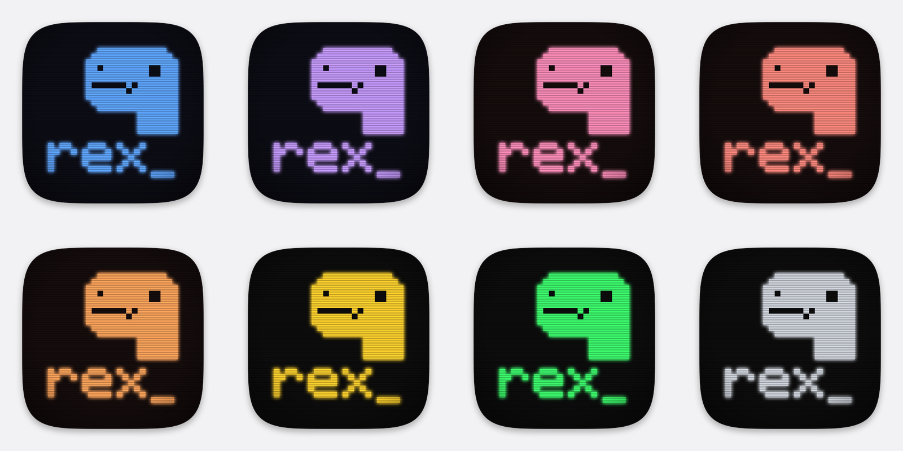

# rex-icons

Set of icons to use as a temporary replacement for [Rex Beta](https://www.superlogical.com/updates/public-testing-beginning).

Two styles, eight colors each, all 1024×1024 PNG.

## Modern Geek



## Retro Pixel



## Files

Icons are named `rex_<style>_<color>.png`:

| Color    | Modern Geek                                                   | Retro Pixel                                                   |
| -------- | ------------------------------------------------------------- | ------------------------------------------------------------- |
| Blue     | [rex_modern_geek_blue.png](icons/rex_modern_geek_blue.png)         | [rex_retro_pixel_blue.png](icons/rex_retro_pixel_blue.png)         |
| Purple   | [rex_modern_geek_purple.png](icons/rex_modern_geek_purple.png)     | [rex_retro_pixel_purple.png](icons/rex_retro_pixel_purple.png)     |
| Pink     | [rex_modern_geek_pink.png](icons/rex_modern_geek_pink.png)         | [rex_retro_pixel_pink.png](icons/rex_retro_pixel_pink.png)         |
| Red      | [rex_modern_geek_red.png](icons/rex_modern_geek_red.png)           | [rex_retro_pixel_red.png](icons/rex_retro_pixel_red.png)           |
| Orange   | [rex_modern_geek_orange.png](icons/rex_modern_geek_orange.png)     | [rex_retro_pixel_orange.png](icons/rex_retro_pixel_orange.png)     |
| Yellow   | [rex_modern_geek_yellow.png](icons/rex_modern_geek_yellow.png)     | [rex_retro_pixel_yellow.png](icons/rex_retro_pixel_yellow.png)     |
| Green    | [rex_modern_geek_green.png](icons/rex_modern_geek_green.png)       | [rex_retro_pixel_green.png](icons/rex_retro_pixel_green.png)       |
| Graphite | [rex_modern_geek_graphite.png](icons/rex_modern_geek_graphite.png) | [rex_retro_pixel_graphite.png](icons/rex_retro_pixel_graphite.png) |

## Replacing the Rex icon on macOS

### Finder

1. Open the PNG you like in **Preview** and copy it (`⌘A`, `⌘C`).
2. In **Finder**, go to `/Applications`, select **Rex Beta**, and press `⌘I` (Get Info).
3. Click the small icon in the top-left corner of the Info window so it gets highlighted.
4. Paste (`⌘V`). Enter your password if asked.
5. Quit and reopen Rex (`⌘Q`) to see the new icon in the Dock.

### Terminal

Same result without clicking around, using only built-in tools:

```sh
ICON="$PWD/icons/rex_modern_geek_blue.png"
APP="/Applications/Rex Beta.app"

osascript -l JavaScript -e "
  ObjC.import('AppKit');
  \$.NSWorkspace.sharedWorkspace.setIconForFileOptions(
    \$.NSImage.alloc.initWithContentsOfFile('$ICON'), '$APP', 0)"
```

Then quit and reopen Rex (`⌘Q`) to see the new icon in the Dock.

### Restoring the default icon

Open Get Info on **Rex Beta**, select the icon in the top-left corner, and press `Delete`.

> [!NOTE]
> A custom icon is stored on the app bundle, so a Rex update may reset it. Just apply it again.

## License

[MIT](LICENSE)
